# FSP Brand Guidelines — FlySapa

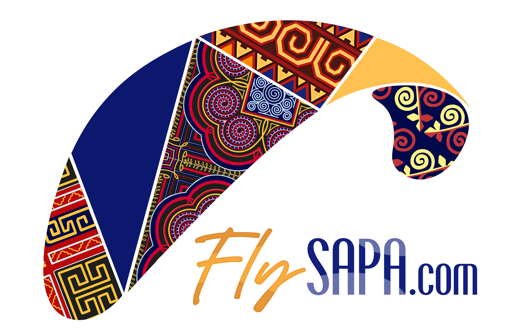

FlySapa (FSP) — dịch vụ bay dù lượn đôi và dù động cơ ở Sa Pa, cất cánh từ điểm bay cao nhất Việt Nam. Ấn phẩm của FSP là standee, poster báo giá, banner quảng cáo onsite, poster hướng dẫn và biển chỉ dẫn tại điểm bay: chữ to, rõ, đọc được từ xa, ảnh thật của khách đang bay giữa ruộng bậc thang và biển mây.

## Giọng văn & nội dung

- **Ngôn ngữ.** Biển hướng dẫn và an toàn tại điểm bay: song ngữ trong cùng một ấn phẩm, tiếng Anh trước VIẾT HOA, tiếng Việt nhỏ hơn ngay dưới hoặc trong dấu `/…/` (“HELMET — Thắt mũ bảo hiểm”, “Leg straps /Đai đùi/”). Poster báo giá và quảng cáo: làm **hai bản riêng** Việt và Anh cùng bố cục, không trộn hai ngôn ngữ trên một bản (“Nâng tầm CHUYẾN BAY” ↔ “Level up YOUR FLIGHT”; “CẤT CÁNH TỪ ĐIỂM BAY CAO NHẤT VIỆT NAM” ↔ “LAUNCHING FROM VIETNAM’S HIGHEST TAKE-OFF”).
- **Hào hứng, thân thiện, ngắn.** Câu mệnh lệnh ngắn và lời rủ rê: “BOOK YOUR FLIGHT HERE”, “SEE YOU UP THERE”, “HOW TO TAKE-OFF LIKE A PRO”, “Get your BUSINESS done here, there are only CLOUD up there!”. Được phép đùa nhẹ (“FLY SAPAAA”).
- **Điểm khác biệt luôn được nhắc**: điểm bay cao nhất — “HIGHEST SITE IN VIETNAM”, “The Higher Take-off Site in Sapa”.
- **An toàn nói thẳng.** Quy tắc an toàn dùng cặp ✗ / ✓ kèm chữ: “✗ DON’T STOP OR SIT DOWN” · “✓ ALWAYS RUN & LOOK AHEAD”. Không chỉ dựa vào màu đỏ/xanh — luôn có biểu tượng và chữ.
- **Giá dịch vụ phụ ghi cả USD và VND**: `$32/800.000VND` — USD trước, VND dùng dấu chấm ngăn nghìn, viết liền “VND”, luôn trong PriceTag, kèm chú thích nhỏ “*áp dụng theo từng khách” / “*per person”. **Giá gói bay chính** viết rút gọn kiểu `2390K` kèm `$95` nhỏ bên phải, trong PriceHero.
- Quyền lợi gói liệt kê bằng dấu ✦: “✦ Chuyến bay ✦ Đưa đón tận nơi ✦ Bảo hiểm bay” / “✦ The flight ✦ Round-trip transfer ✦ Insurance”.
- Từ khoá bán hàng được in đậm hoặc đặt trên nền `keyword-bg`: “every angle”, “panoramic view”, “ultimate cinematic experience”.
- Liên hệ dùng thống nhất: hotline **(+84) 58.414.6688**, website **flysapa.com**, TikTok **@flysapa**, Instagram **flysapa_paragliding**, Zalo / WhatsApp.
- Không dùng emoji trong ấn phẩm; dùng biểu tượng ✓ ✗, ngôi sao lấp lánh ✦ nhỏ làm trang trí.

## Logo

- Logo chính là **logo dương bản** `assets/Logos/fsp-logo-duong.png`: cánh dù ghép từ hoa văn thổ cẩm (navy, vàng mặt trời, đỏ, đen) với chữ “Fly” vàng cam và “SAPA.com” navy. Đặt trên nền trắng hoặc nền sáng (`surface`, `sky-tint`, ảnh mây trời sáng). Trên banner onsite, logo dương bản nhỏ ở góc trên bên trái, trên vùng trời sáng của ảnh.
- **Logo âm bản** `assets/Logos/fsp-logo-am.png` là bản trắng một màu (mực: trắng `#ffffff`) — dùng trên `brick`, `sky`, `brand-navy` hoặc ảnh tối. Trên poster đỏ/xanh, logo đặt ở góc trên bên trái, nhỏ (khoảng 6–8% chiều rộng poster).
- **Wordmark lớn “FlySAPA.com”** làm tiêu đề poster báo giá: “Fly” chữ viết tay `brand-gold` → `brand-amber`, “SAPA.com” chữ đậm nghiêng `brand-navy`, bên dưới là viên thuốc trắng chứa tagline (“CẤT CÁNH TỪ ĐIỂM BAY CAO NHẤT VIỆT NAM”) chữ `azure`. Hiện chưa có file wordmark này trong hệ thống — dùng file gốc của designer, không gõ lại bằng font.
- Standee dùng một biến thể cánh dù một màu xanh lá đậm; các poster cũ dùng biến thể cánh dù nét trắng. Hai biến thể này cũng chưa có file trong hệ thống.
- Không đổi màu, kéo giãn, xoay hay thêm hiệu ứng cho logo; giữ khoảng trống quanh logo tối thiểu bằng chiều cao chữ “Fly”.

## Màu sắc

Màu thương hiệu lấy trực tiếp từ logo dương bản:

- `brand-navy` là màu chủ đạo — chữ nội dung và tiêu đề trên nền sáng. `brand-gold` là điểm nhấn ấm; `brand-red`, `brand-crimson`, `brand-lemon`, `brand-amber`, `brand-periwinkle`, `brand-ice`, `brand-charcoal` là bảng màu hoa văn thổ cẩm — dùng cho hoạ tiết, chi tiết trang trí, không dùng làm màu chữ thường.

Ba “không khí” ấn phẩm:

- **Đỏ gạch — an toàn & hướng dẫn**: nền `brick`, chữ `on-dark`, chữ nhấn `cream`. Ví dụ: Take-off Check List, How to Take-off Like a Pro, khung viền poster Restroom.
- **Xanh trời — thông tin & dịch vụ phụ**: nền `sky` (hoặc ảnh mây), thẻ trắng `surface` với dải đầu `sky-tint`, tiêu đề `cobalt`. Ví dụ: Level Up Your Flight, Paragliding in Sapa.
- **Ruộng bậc thang — bán vé onsite, standee, poster báo giá**: ảnh toàn khung ruộng bậc thang / rừng, lớp phủ `meadow` mờ (poster báo giá, standee) hoặc chuyển sang `forest` ở chân ảnh (banner). Tiêu đề trắng, dòng thứ hai `cream`, giá trong PriceHero và PriceTag, hotline ở chân. Ví dụ: Book Your Flight Here, FlySapa Ticket Office, poster báo giá 2390K, standee The Higher Take-off Site.
- Giá dịch vụ phụ là PriceTag (`price-red` trên nền thẻ sáng; bản sáng `sky-tint` trên ảnh); số hotline là viên thuốc `royal` hoặc `brand-amber`; nhãn quyền lợi (“BAO GỒM GO PRO”) là viên thuốc `royal`.
- Trắng trên `sky` chỉ đạt 2.8:1: tiêu đề trắng trên `sky` phải ≥48px, đậm và có `shadow-title`; chữ nhỏ luôn nằm trong thẻ `surface`. Trên ảnh, chữ trắng chỉ đặt ở vùng đã phủ `forest`/`meadow` hoặc có `shadow-title`. `success`, `teal`, `jade` giữ đúng màu ấn phẩm nhưng không đủ tương phản cho chữ nhỏ — chỉ dùng cỡ lớn, kèm biểu tượng hoặc viền trắng dày.
- Gradient chỉ dùng giữa hai token đã có: số giá `jade` → `lagoon`; chữ “Fly” `brand-gold` → `brand-amber`; lớp phủ ảnh trong suốt → `forest`.

## Chữ

- **Tiêu đề: DT-Phudu** (`display`) — chữ hẹp, đậm, VIẾT HOA: `display-xl` cho tiêu đề poster/banner, `display-l`, `heading` cho tiêu đề mục, `price-hero` cho giá gói chính, `price` cho PriceTag. Phudu có trên Google Fonts (hỗ trợ tiếng Việt); bản “DT-Phudu” cài trong máy thiết kế dùng cùng tên.
- **Nội dung: Poppins** (`body`) — `title` (800, VIẾT HOA) cho tên dịch vụ như INSTA360, DRONE, BEST PRICE COMBO, “HIGHEST SITE IN VIETNAM”; `subtitle` cho nhãn; `body-lg` cho mô tả trong thẻ; `body` cho đoạn văn/danh sách; `caption` cho dòng tiếng Việt phụ và chú thích “*per person”.
- Nạp font web: `https://fonts.googleapis.com/css2?family=Phudu:wght@400;600;700;800;900&family=Poppins:ital,wght@0,400;0,500;0,600;0,700;0,800;1,400;1,700&display=swap`.
- Tiêu đề banner onsite xếp 2–4 dòng, mỗi dòng 1–2 từ, căn trái, dòng nhấn đổi sang `cream` (“BOOK / YOUR / **FLIGHT** / HERE”; “FLYSAPA / **TICKET OFFICE**”).
- Chữ nhấn kiểu viết tay/bút lông (“TAKE-OFF”, “FLY SAPAAA”, “CLOUD” phồng, “The Higher Take-off Site in Sapa” trắng viền `brand-navy` dày, “Nâng tầm / Level up” Poppins thường đặt trên chữ Phudu lớn) chỉ dùng cho 1–2 cụm trên một ấn phẩm. Đây là chữ minh hoạ, không phải font hệ thống.

## Ấn phẩm theo định dạng

- **Standee (khổ đứng ~1:2.2)**: logo trên cùng bên trái; ảnh cánh dù lớn nửa trên; tiêu đề viết tay ở giữa đè lên ảnh polaroid nghiêng; “CONTACT US” + hotline; chân là hàng icon mạng xã hội (TikTok @flysapa, Instagram flysapa_paragliding, WhatsApp) và QR bên phải.
- **Poster báo giá (khổ A đứng)**: wordmark FlySAPA.com + tagline trên cùng; PriceHero bên trái ở 1/3 trên; danh sách quyền lợi ✦ bên phải; nửa dưới là khối dịch vụ phụ (“Nâng tầm CHUYẾN BAY” + ảnh Insta360/drone đã tách nền) với hai PriceTag bản sáng xếp dọc và chú thích “*áp dụng theo từng khách”; góc dưới trái Zalo + WhatsApp + hotline `brand-amber`. Làm bản Việt và bản Anh cùng bố cục.
- **Banner onsite (khổ A đứng, quầy vé)**: ảnh toàn khung, logo nhỏ góc trên trái, tiêu đề Phudu trắng lớn căn trái nửa trên, dòng nhấn `cream`; một câu khẳng định ngắn (“HIGHEST SITE IN VIETNAM”, “WITH FLYSAPA.COM”) ở phải; chân ảnh chuyển `forest` chứa “flysapa.com” và hotline căn giữa, chữ trắng `caption`/`subtitle`.

## Bố cục & hình ảnh

- Poster: tiêu đề lớn căn giữa hoặc căn trái phía trên, lưới thẻ bên dưới, lề `space-5`. Nền đỏ/xanh có hoạ tiết thổ cẩm hoặc lưới ô vuông mờ rất nhẹ (độ đậm ~5%).
- Thẻ nội dung: `surface`, bo `radius-card`, bóng `shadow-card`, dải đầu `sky-tint` chứa tên dịch vụ + PriceTag, phần dưới chứa mô tả.
- Thẻ kính mờ (PriceHero) trên ảnh: nền trắng mờ ~70% có làm mờ phía sau, bo `radius-glass`.
- Ảnh: ảnh thật khách bay đôi, dù động cơ, ruộng bậc thang, biển mây Sa Pa — trời xanh, lúa xanh/vàng, màu tươi bão hoà. Ảnh phụ đặt trong khung viền trắng dày như ảnh polaroid, bo `radius-photo`, **xoay nhẹ 3–6°**, bóng `shadow-photo`, có thể kèm nhãn chữ cong (“Insta360”, “Drone”, “Epic aerial View”) và sao lấp lánh nhỏ. Thiết bị (GoPro, Insta360, drone) dùng ảnh sản phẩm đã tách nền.
- Danh sách kiểm tra: bảng viền trắng mảnh, dòng ngăn bằng nét chấm, mỗi dòng “Tiếng Anh /Tiếng Việt/”.
- Không dùng gradient tím-xanh, thẻ viền màu bên trái hay emoji trang trí.

## Biểu tượng

- Ấn phẩm hiện dùng biểu tượng ✓ / ✗ cỡ lớn, dấu ✦ cho danh sách quyền lợi, vòng tròn vàng `brand-lemon` khoanh chi tiết trên ảnh thiết bị, biểu tượng cấm (vòng đỏ gạch chéo), biểu tượng nhà vệ sinh dạng đặc, và icon ứng dụng gốc (Zalo, WhatsApp, TikTok, Instagram) giữ nguyên màu của hãng. Chưa có bộ icon riêng — dùng biểu tượng đặc, góc tròn, một màu theo token.

## Tệp trong repo

| Tệp | Nội dung |
| --- | --- |
| `tokens.json` | Toàn bộ màu, cỡ chữ, khoảng cách, bo góc, bóng đổ |
| `fsp-logo-duong.png`, `fsp-logo-am.png` | Logo dương bản / âm bản — xem `LOGOS.md` |
| `PriceTag.md`, `PriceHero.md` | Hướng dẫn dùng nhãn giá và thẻ giá gói chính |
| `*-preview.html` | Bản dựng mẫu của PriceTag, PriceHero và trang bìa (dùng biến màu từ `tokens.json`) |
| `EXAMPLES.md` + các ảnh `.png` còn lại | Ấn phẩm thật dùng làm mẫu |

## Ấn phẩm mẫu

| | | |
| --- | --- | --- |
| 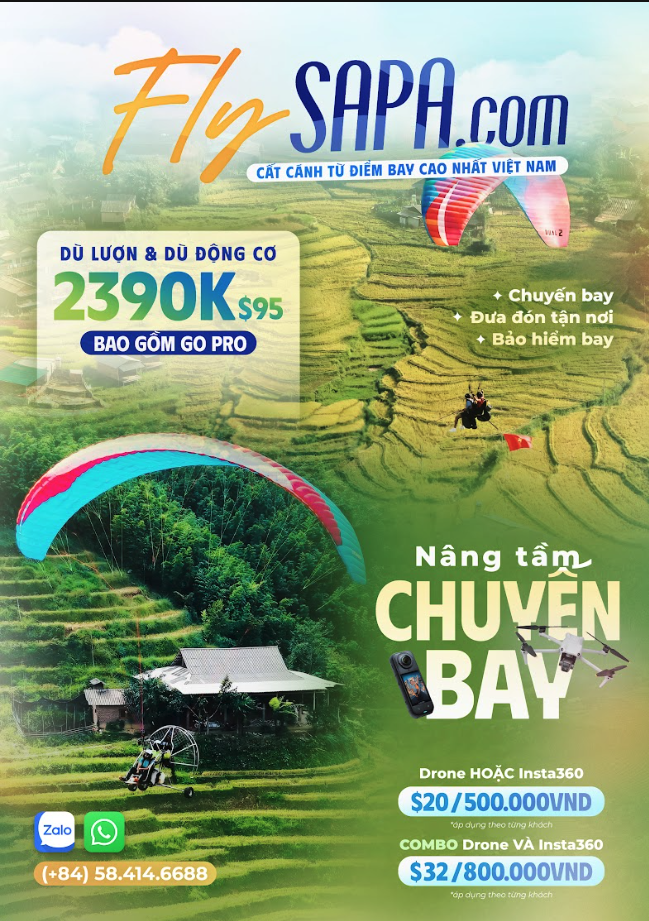 | 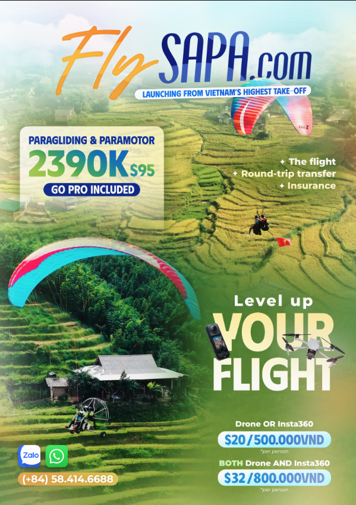 | 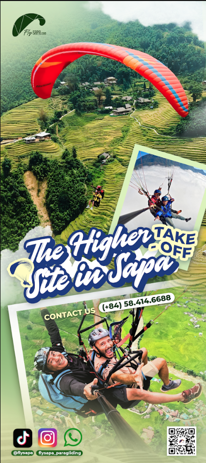 |
|  | 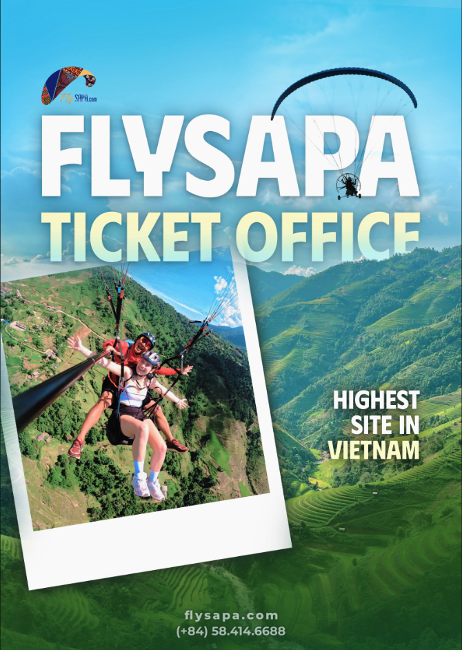 | 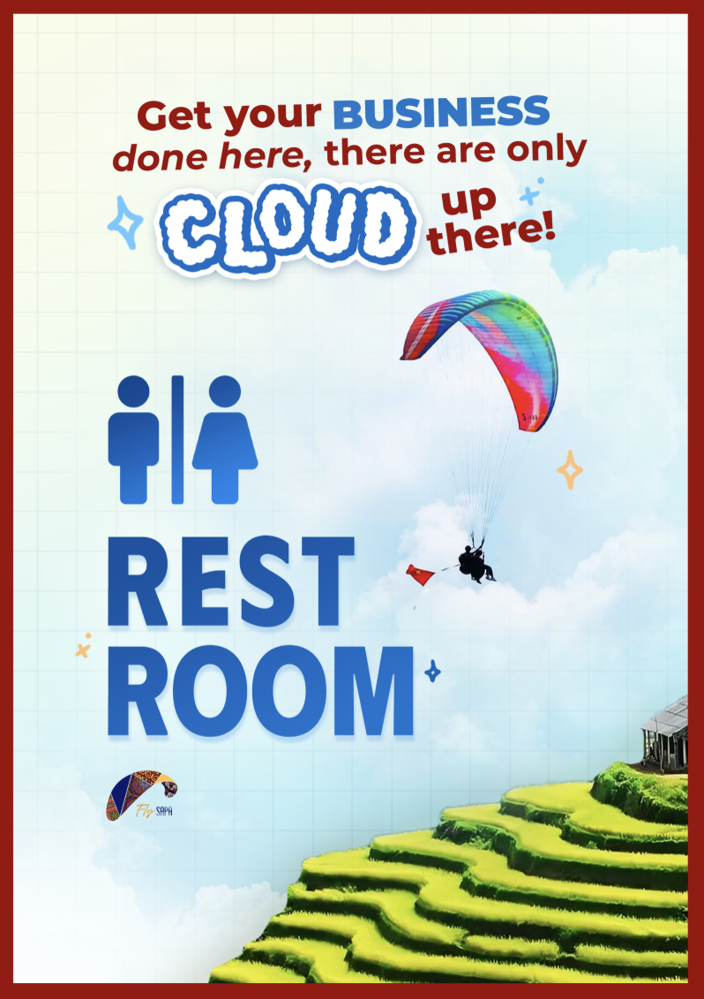 |
| 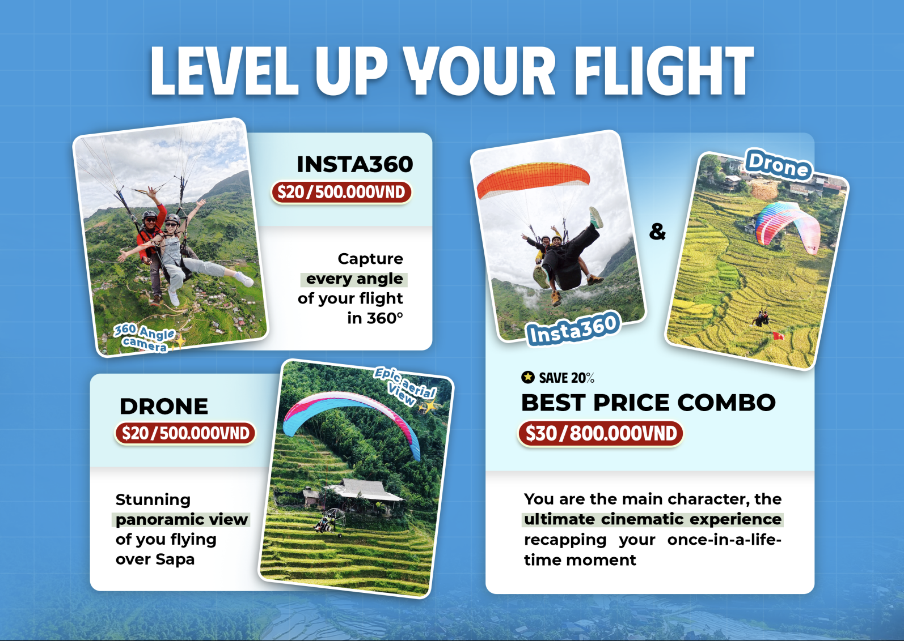 | 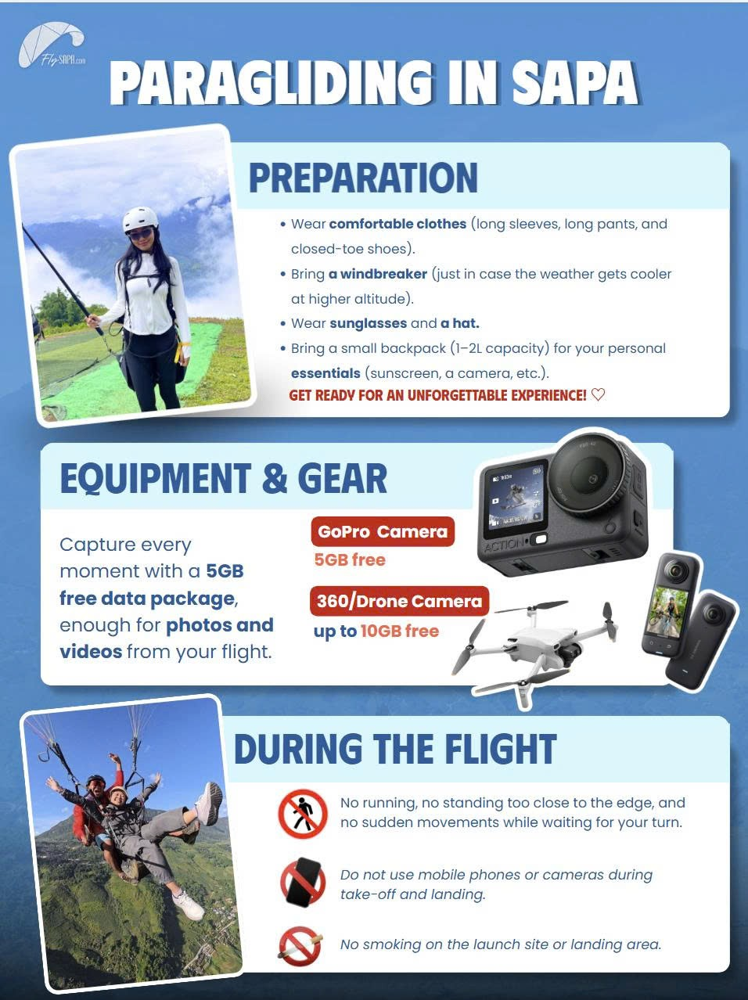 | 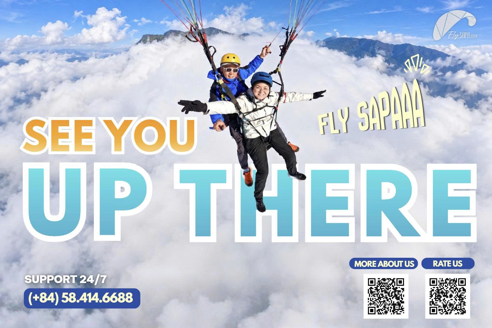 |
| 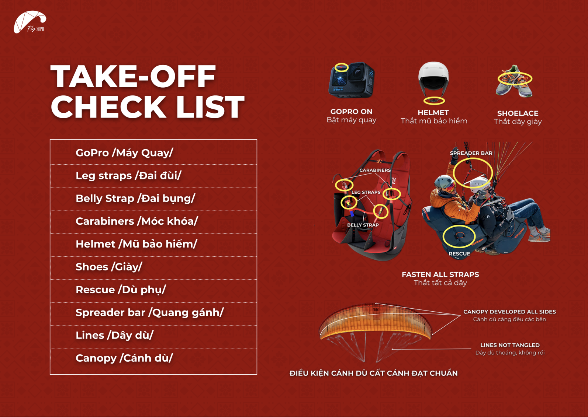 | 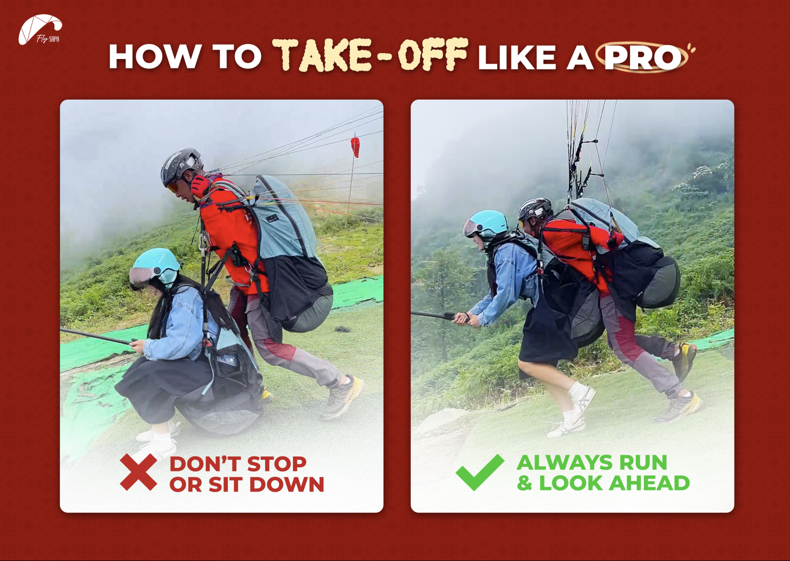 | |
